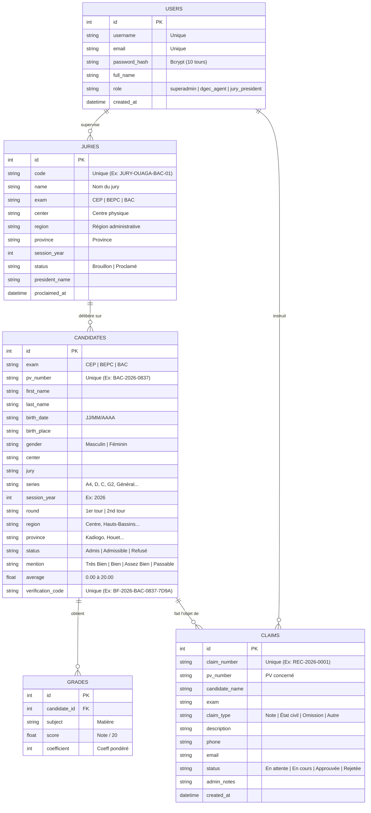
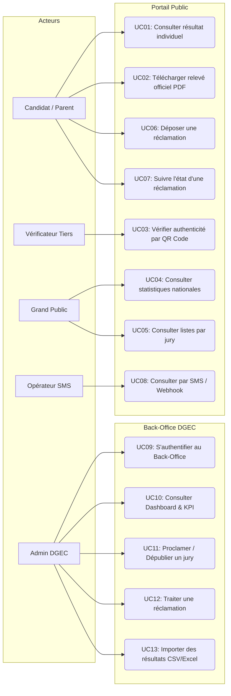
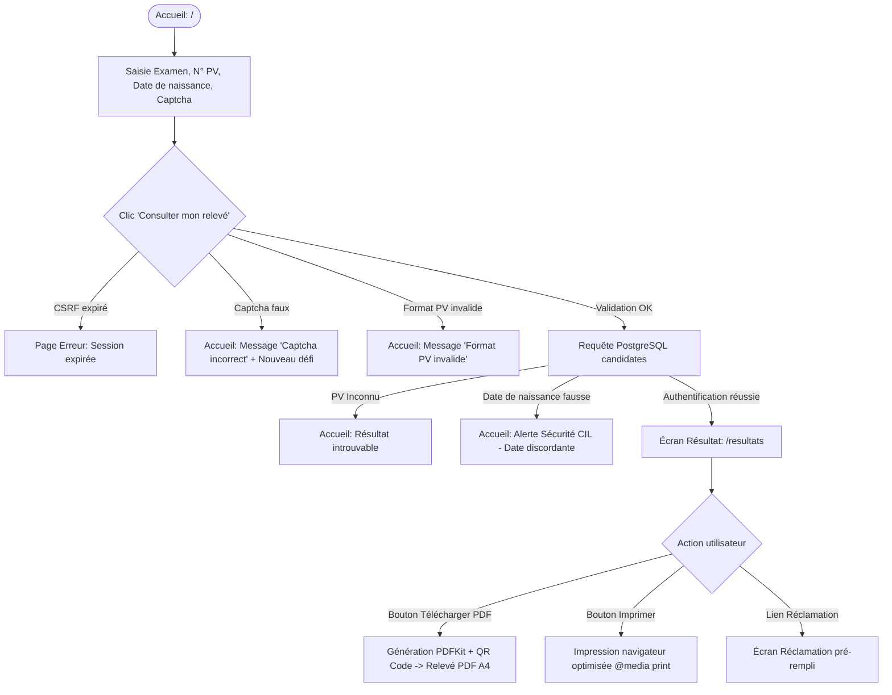
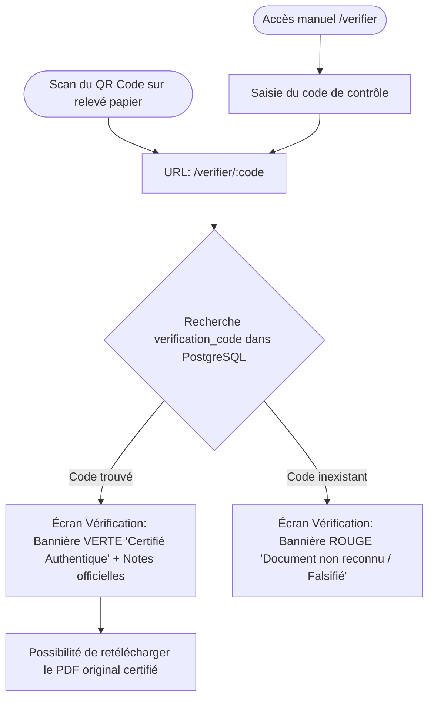
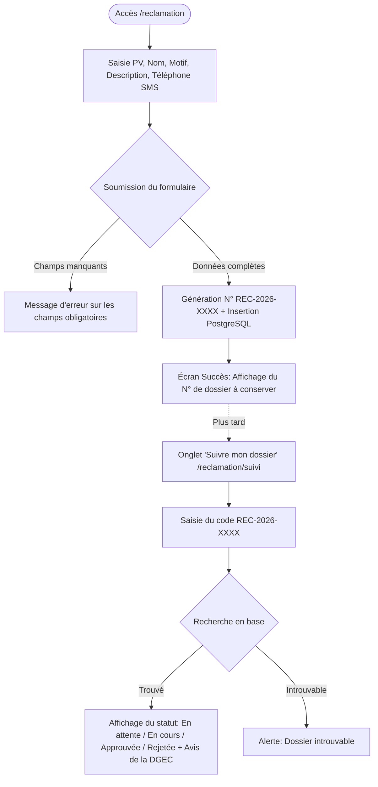
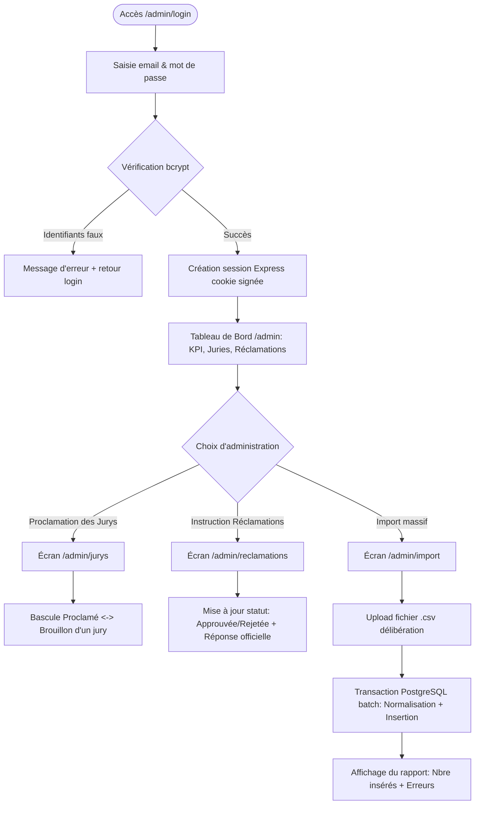
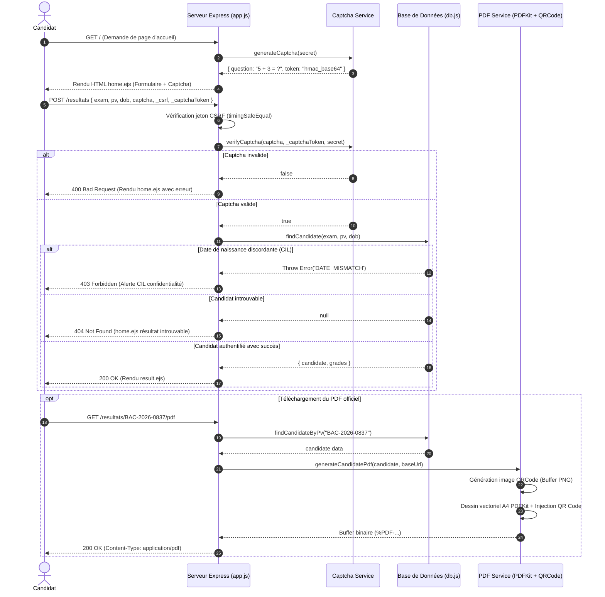
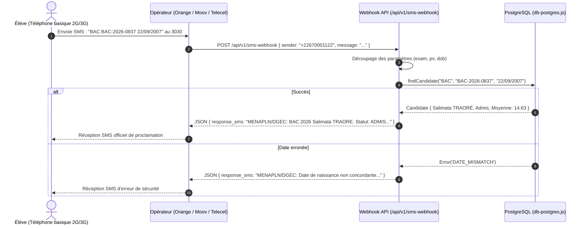
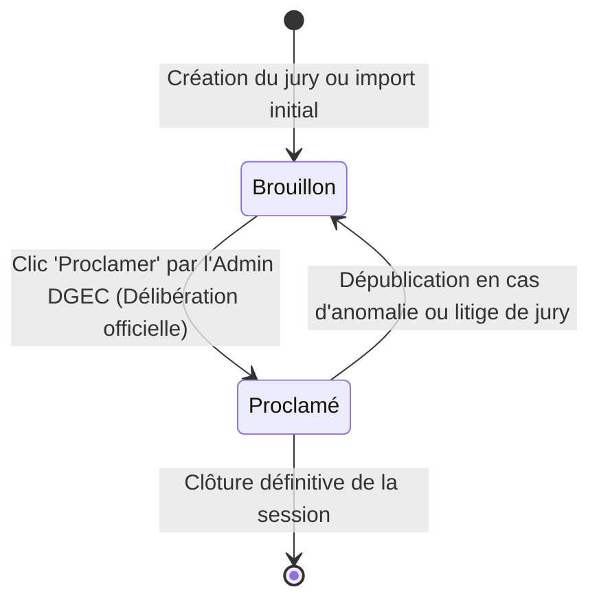
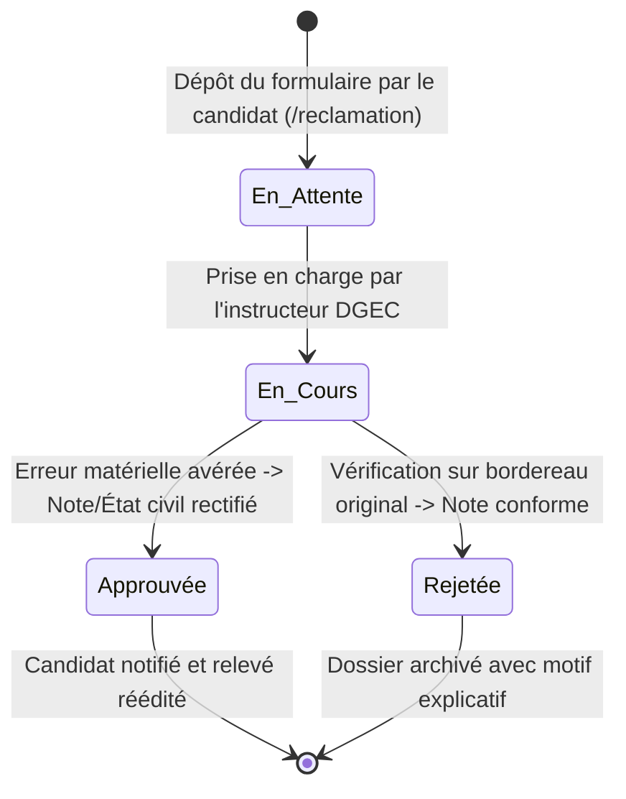

# DOSSIER DE CONCEPTION — PROJET INDÉPENDANT DE DÉMONSTRATION
## Exemple de portail de résultats d'examens — Burkina Faso

> Ce document décrit un prototype indépendant. Il ne représente ni un système officiel, ni un partenariat ou une approbation du MENAPLN, de la DGEC ou d'une autre administration. Les données de démonstration sont fictives et les parcours décrits ne doivent pas être utilisés avec des résultats ou renseignements réels.

---

> **Note à l'attention du concepteur / modélisateur :**  
> Ce document est rédigé de façon exhaustive afin de vous fournir l'ensemble des éléments indispensables à la réalisation de vos **diagrammes UML** (Cas d'utilisation, Classes, Séquences, Activités, États-Transitions) ainsi que vos **User Flows UX** (parcours utilisateurs écran par écran, embranchements et cas d'erreurs).

---

## SOMMAIRE

1. [Cartographie des Acteurs & Parties Prenantes](#1-cartographie-des-acteurs--parties-prenantes)
2. [Modèle de Données & Entités (Pour MCD / MLD / Diagramme de Classes)](#2-modèle-de-données--entités-pour-mcd--mld--diagramme-de-classes)
3. [Règles Métier Nationales (Business Rules)](#3-règles-métier-nationales-business-rules)
4. [Matrice Exhaustive des Cas d'Utilisation (Use Cases)](#4-matrice-exhaustive-des-cas-dutilisation-use-cases)
5. [User Flows Détaillés (Parcours Utilisateurs Écran par Écran)](#5-user-flows-détaillés-parcours-utilisateurs-écran-par-écran)
6. [Diagrammes de Séquence & Flux Techniques](#6-diagrammes-de-séquence--flux-techniques)
7. [Cycle de Vie des Données (Diagrammes d'États-Transitions)](#7-cycle-de-vie-des-données-diagrammes-détats-transitions)
8. [Matrice des Endpoints HTTP & Contrats d'Interface](#8-matrice-des-endpoints-http--contrats-dinterface)

## Module ajouté : inscriptions candidats

Le portail distingue maintenant les résultats publiés après délibération des dossiers d'inscription créés pendant la campagne scolaire.

- Un compte candidat est identifié par son téléphone et son mot de passe.
- Un compte peut posséder plusieurs dossiers, mais un paiement ne peut viser qu'un dossier appartenant à ce compte.
- Le paiement actuel est explicitement simulé et produit une référence `PAY-...`, un événement d'audit technique et le statut `Payé`.
- Les pages publiques de jurys donnent uniquement le jury, le centre, la session et les compteurs. Elles ne divulguent ni nom, ni moyenne, ni PV, ni code QR.
- Le paiement réel devra être intégré par webhook opérateur signé avant toute mise en production.

---

## 1. CARTOGRAPHIE DES ACTEURS & PARTIES PRENANTES

| Acteur | Type | Description & Périmètre de responsabilité |
| :--- | :--- | :--- |
| **Candidat / Élève** | Humain (Externe) | Élève ayant composé au CEP, BEPC ou Baccalauréat. Consulte son relevé, télécharge son PDF, dépose et suit une réclamation. |
| **Parent / Tuteur** | Humain (Externe) | Consulte les résultats de ses enfants à l'aide des identifiants officiels de convocation. |
| **Vérificateur Tiers** | Humain (Externe) | Université (nationale ou étrangère), employeur, consulat ou organisme voulant attester de l'authenticité d'un relevé en scannant son QR Code. |
| **Grand Public / Chercheur** | Humain (Externe) | Citoyens et analystes consultant les statistiques nationales et les listes officielles des admis par jury. |
| **Opérateur Télécom** | Système (Externe) | Passerelles SMS / serveurs vocaux (Orange BF, Moov Africa, Telecel) interrogeant le portail via l'API webhook pour les consultations sans Internet. |
| **Super-Administrateur DGEC** | Humain (Interne) | Cadre du MENAPLN disposant des pleins pouvoirs : import de fichiers CSV, publication des jurys, supervision nationale. |
| **Agent / Président de Jury** | Humain (Interne) | Responsable de centre validant les délibérations et traitant les contestations/réclamations des candidats. |
| **Système National (Serveur)** | Automatique | Exécute les contrôles CSRF, le captcha HMAC, le calcul des moyennes et la génération cryptographique des QR Codes. |

---

## 2. MODÈLE DE DONNÉES & ENTITÉS (Pour MCD / MLD / Diagramme de Classes)

Le schéma est structuré autour de 5 entités principales interconnectées :

---

## 3. RÈGLES MÉTIER NATIONALES (Business Rules - BR)

Ces règles découlent des décrets et règlements officiels de la DGEC et de la CIL :

* **`BR-01` (Confidentialité CIL)** : La consultation détaillée des notes et de l'état civil d'un candidat est strictement conditionnée à la fourniture conjointe du **Numéro de PV** et de la **Date de naissance**. Toute discordance bloque l'affichage (`DATE_MISMATCH`).
* **`BR-02` (Calcul de la Moyenne Générale)** :
  $$\text{Moyenne} = \frac{\sum (\text{Note}_i \times \text{Coefficient}_i)}{\sum \text{Coefficient}_i}$$
  La note est sur 20, arrondie à 2 décimales.
* **`BR-03` (Statuts d'Admission)** :
  * **Admis** : Moyenne $\ge 10{,}00/20$ au premier tour.
  * **Admissible (2nd tour)** : Moyenne comprise entre $09{,}00$ et $09{,}99/20$ au Baccalauréat ou au BEPC, ouvrant droit aux épreuves de rattrapage / rachat.
  * **Refusé / Ajourné** : Moyenne $< 09{,}00/20$ (ou $< 10{,}00/20$ après les épreuves du second tour).
* **`BR-04` (Attribution des Mentions)** :
  * $\text{Moyenne} \ge 16{,}00$ : **Très Bien**
  * $14{,}00 \le \text{Moyenne} < 16{,}00$ : **Bien**
  * $12{,}00 \le \text{Moyenne} < 14{,}00$ : **Assez Bien**
  * $10{,}00 \le \text{Moyenne} < 12{,}00$ : **Passable**
  * Candidat admissible au 2nd tour : Mention **Passable (2nd tour)**.
* **`BR-05` (Code de Contrôle Cryptographique)** : Chaque candidat possède un identifiant unique immuable au format `BF-{ANNÉE}-{EXAMEN}-{PV_COURT}-{HASH4}`. Ce code est encodé dans le QR Code vectoriel du PDF.
* **`BR-06` (Protection Anti-Robot Stateless)** : Chaque formulaire de recherche génère un défi d'addition `A + B = ?`. Le résultat et l'horodatage sont scellés dans un jeton base64 signé par HMAC-SHA256 avec la clé secrète du serveur. Durée de validité : **5 minutes**.
* **`BR-07` (Proclamation Officielle)** : Les listes de candidats ne sont visibles sur le babillard public (`/proclamations`) que si le jury associé possède le statut `Proclamé`.
* **`BR-08` (Attribution de Dossier de Recours)** : Toute réclamation validée génère immédiatement un numéro de suivi unique `REC-{ANNÉE}-{HEX6}` communiqué au requérant.

---

## 4. MATRICE EXHAUSTIVE DES CAS D'UTILISATION (Use Cases)

### Fiches descriptives des Use Cases majeurs :

#### `UC01` : Consulter son résultat individuel
* **Acteur principal** : Candidat ou Parent.
* **Préconditions** : Disposer de son numéro de PV et de sa date de naissance figurant sur la convocation officielle.
* **Déclencheur** : Soumission du formulaire sur `/` vers `/resultats`.
* **Flux nominal** :
  1. L'utilisateur sélectionne l'examen (`CEP`, `BEPC`, `BAC`).
  2. L'utilisateur renseigne son numéro de PV (ex. `BAC-2026-0837`).
  3. L'utilisateur renseigne sa date de naissance (`22/09/2007`).
  4. L'utilisateur résout le calcul anti-robot (ex. `4 + 5 = 9`).
  5. Le système vérifie le jeton CSRF et le HMAC du Captcha.
    6. Le système compare la date de naissance avec PostgreSQL.
  7. Le système affiche la page de résultat avec état civil, série, tour, moyennes, notes et bouton PDF.
* **Flux d'exceptions** :
  * *4a. Captcha incorrect ou expiré* : Réaffichage du formulaire avec message d'erreur et nouveau Captcha.
  * *6a. PV introuvable* : Affichage de l'erreur « Aucun résultat ne correspond aux références saisies ».
  * *6b. Date de naissance erronée* : Rejet `DATE_MISMATCH` avec alerte CIL de non-concordance.

#### `UC02` : Télécharger le relevé officiel (PDF vectoriel avec QR Code)
* **Acteur principal** : Candidat.
* **Déclencheur** : Clic sur le bouton « Télécharger Relevé PDF Officiel » (`/resultats/:pv/pdf`).
* **Traitement système** :
  1. Récupération des données du candidat et de ses notes par son PV.
  2. Génération du QR Code contenant l'URL absolue `/verifier/:verification_code`.
  3. Construction en mémoire avec `PDFKit` du gabarit A4 officiel (bande bicolore burkinabè, logos, tableau des notes, décision du jury, tampon et QR Code).
  4. Envoi du flux binaire avec l'en-tête `Content-Disposition: inline; filename="Releve_BAC_...pdf"`.

#### `UC03` : Vérifier l'authenticité d'un relevé via QR Code
* **Acteur principal** : Recruteur, Université, Ambassade, Autorité de contrôle.
* **Déclencheur** : Scan du QR Code avec un smartphone ou saisie manuelle du code sur `/verifier`.
* **Flux nominal** :
  1. L'utilisateur accède à `/verifier/BF-2026-BAC-0837-7D9A`.
  2. Le système cherche le candidat associé au code de vérification unique.
  3. Le système affiche la bannière verte « Document Officiel Authentique Certifié » avec l'état civil, les notes certifiées et la décision d'origine.
* **Flux alternatif** :
  * Si le code n'existe pas : Bannière rouge « Document Non Reconnu ou Code Invalide » signalant une tentative de contrefaçon.

#### `UC13` : Importer massivement des résultats par fichier CSV
* **Acteur principal** : Super-Administrateur DGEC.
* **Préconditions** : Être authentifié dans l'espace `/admin`.
* **Déclencheur** : Téléversement d'un fichier `.csv` sur `/admin/import`.
* **Traitement système** :
  1. `Multer` intercepte le fichier en mémoire vive (RAM).
  2. Détection dynamique du délimiteur (`;` ou `,`).
  3. Vérification de la présence des colonnes indispensables.
    4. Lancement d'une **transaction atomique PostgreSQL** (`BEGIN`).
  5. Pour chaque ligne : normalisation de la date, génération automatique du code de vérification s'il est absent, calcul de la moyenne, insertion/mise à jour du candidat.
  6. Si toutes les lignes sont valides : `COMMIT` et affichage du rapport (nombre d'enregistrements insérés, liste des anomalies éventuelles). En cas de plantage critique : `ROLLBACK`.

---

## 5. USER FLOWS DÉTAILLÉS (Parcours Utilisateurs Écran par Écran)

### User Flow 1 : Parcours Candidat (Consultation & Relevé)

---

### User Flow 2 : Parcours Vérificateur d'Authenticité (Scan QR Code)

---

### User Flow 3 : Parcours Candidat (Gestion des Réclamations)

---

### User Flow 4 : Parcours Administrateur DGEC (Back-Office & Import)

---

## 6. DIAGRAMMES DE SÉQUENCE & FLUX TECHNIQUES

### Séquence 1 : Consultation Sécurisée et Génération du Relevé PDF

---

### Séquence 2 : Passerelle SMS Opérateur Télécom (Consultation hors-ligne)

---

## 7. CYCLE DE VIE DES DONNÉES (Diagrammes d'États-Transitions)

### État d'une Délibération de Jury (`JURIES.status`)

### État d'une Réclamation Candidat (`CLAIMS.status`)

---

## 8. MATRICE DES ENDPOINTS HTTP & CONTRATS D'INTERFACE

| Méthode | Route | Rôle & Traitement | Entrées requises | Code retour HTTP |
| :--- | :--- | :--- | :--- | :--- |
| `GET` | `/` | Affiche le formulaire d'accueil et génère un Captcha | Aucun | `200 OK` |
| `POST` | `/resultats` | Vérifie Captcha, CSRF, PV + Date et affiche les notes | `exam`, `pv`, `dob`, `captcha`, `_csrf`, `_captchaToken` | `200`, `400`, `403`, `404` |
| `GET` | `/resultats/:pv/pdf` | Génère et télécharge le relevé PDF avec QR Code | Paramètre d'URL `:pv` | `200 (PDF)`, `404` |
| `GET` | `/verifier/:code?` | Vérifie l'authenticité d'un relevé officiel scanné | Paramètre d'URL `:code` ou query `?code=` | `200 OK` |
| `GET` | `/statistiques` | Tableau de bord public des performances et taux | Aucun | `200 OK` |
| `GET` | `/proclamations` | Affichage public des listes d'admis par jury | Query optionnelles `?exam=&jury=` | `200 OK` |
| `GET` | `/reclamation` | Affiche le formulaire de dépôt de contestation | Query optionnelles `?pv=&exam=` | `200 OK` |
| `POST` | `/reclamation` | Enregistre une réclamation et fournit le N° de suivi | `exam`, `pv_number`, `candidate_name`, `claim_type`, `description`, `phone` | `200 OK`, `400` |
| `GET` | `/reclamation/suivi` | Permet à l'élève de vérifier le statut de son recours | Query `?claim_number=REC-2026-...` | `200 OK` |
| `GET` | `/admin/login` | Affiche le formulaire d'authentification DGEC | Aucun | `200 OK` |
| `POST` | `/admin/login` | Authentifie l'agent (bcrypt) et initie la session | `identifier`, `password` | `302 (Redirect)`, `401` |
| `GET` | `/admin` | Tableau de bord Back-Office DGEC (KPI & Jurys) | Session admin active | `200 OK`, `302 (vers login)` |
| `GET` | `/admin/jurys` | Liste et contrôle des proclamations de jurys | Session admin active | `200 OK` |
| `POST` | `/admin/jurys/:id/status` | Bascule un jury en `Proclamé` ou `Brouillon` | Paramètre `:id`, champ `status` | `302 (Redirect)` |
| `GET` | `/admin/reclamations` | Interface de traitement des réclamations | Query `?status=` | `200 OK` |
| `POST` | `/admin/reclamations/:id` | Enregistre la décision officielle sur une réclamation | Paramètre `:id`, `status`, `admin_notes` | `302 (Redirect)` |
| `GET` | `/admin/import` | Interface d'importation de résultats en masse | Session admin active | `200 OK` |
| `POST` | `/admin/import` | Upload et insertion transactionnelle d'un fichier CSV | Fichier multipart `csv_file` | `200 OK (Rapport)` |
| `GET` | `/admin/modele-csv` | Téléchargement d'un fichier CSV type pré-rempli | Session admin active | `200 (text/csv)` |
| `GET` | `/api/v1/resultats` | Endpoint REST JSON pour systèmes tiers | Query `?exam=&pv=&dob=` | `200 (JSON)`, `400`, `403`, `404` |
| `POST` | `/api/v1/sms-webhook` | Passerelle Webhook pour SMS opérateurs | JSON `{ sender, message }` | `200 (JSON response_sms)` |
| `GET` | `/health` | Sonde de santé applicative pour monitoring/Docker | Aucun | `200 { status: "UP" }` |

---

## 9. EXEMPLES DE JEUX D'ESSAI POUR VOS DIAGRAMMES

Ces exemples réels issus de la base de données peuvent être directement insérés dans vos scénarios de test ou vos maquettes :

1. **Candidat Admis avec Mention (BAC D)** :
   * N° PV : `BAC-2026-0837` | Date de naissance : `22/09/2007`
   * Identité : Salimata TRAORÉ | Centre : Lycée Provincial de Koudougou | Jury : Jury B
   * Moyenne : `14,63/20` | Mention : `Bien` | Statut : `Admis` (1er tour)
   * Code de vérification QR : `BF-2026-BAC-0837-7D9A`

2. **Candidat Admissible au Second Tour (Rattrapage - BAC A4)** :
   * N° PV : `BAC-2026-0412` | Date de naissance : `14/04/2007`
   * Identité : Ousmane SAWADOGO | Centre : Lycée Nelson Mandela | Jury : Jury 01 Ouaga
   * Moyenne : `10,45/20` | Mention : `Passable (2nd tour)` | Statut : `Admissible`

3. **Candidat Ajourné / Refusé (BAC D)** :
   * N° PV : `BAC-2026-0915` | Date de naissance : `15/01/2008`
   * Identité : Issaka ZONGO | Centre : Lycée Provincial du Yatenga | Jury : Jury C
   * Moyenne : `08,74/20` | Statut : `Refusé`

4. **Compte Administrateur DGEC** :
   * Les comptes sont créés explicitement via la commande `npm run admin:create` avec des variables d'environnement.
